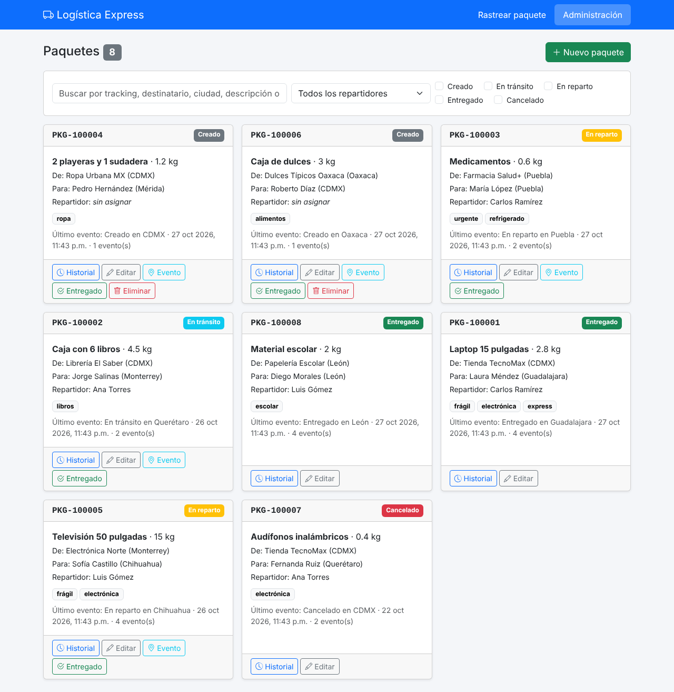
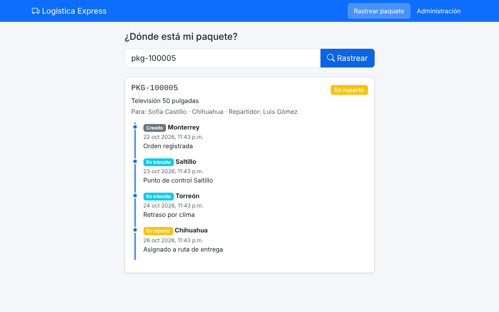
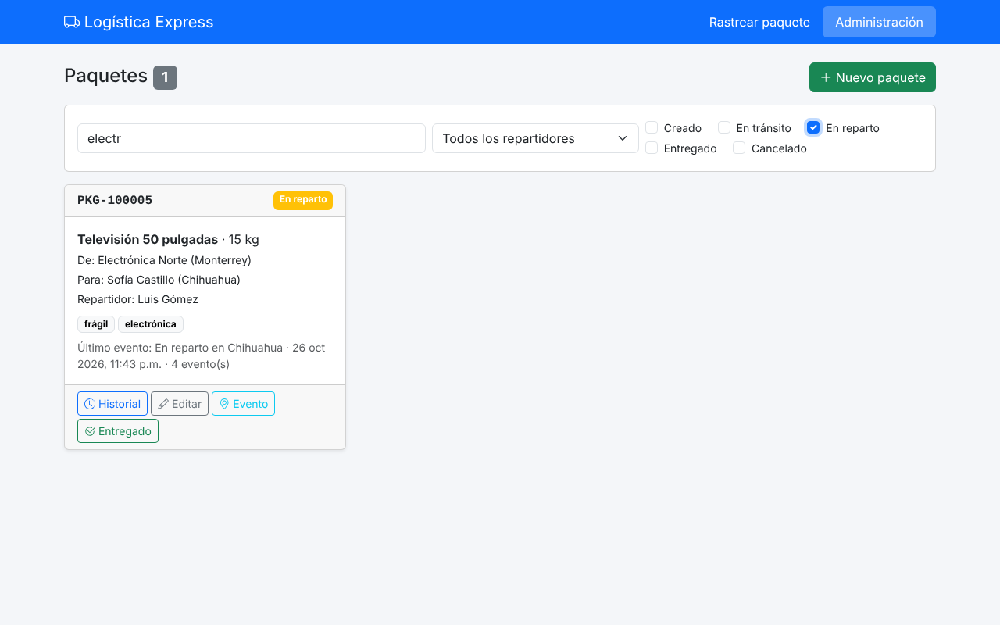
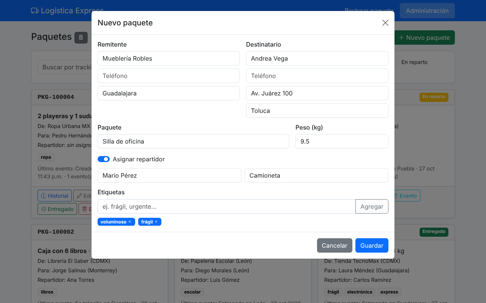
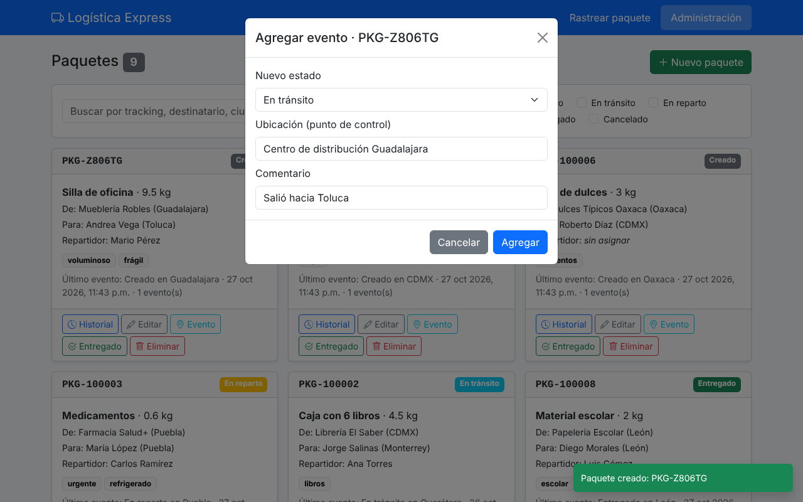

# Logística Express · Sistema de Rastreo de Paquetes (MongoDB Atlas)

Proyecto BD NoSQL, **Opción 5: Sistema de Gestión de Logística, Entregas y Rastreo** (tipo UberEats / DHL).

Un cliente rastrea su paquete con el **código de rastreo** (`tracking_id`). El administrador da de alta paquetes,
los filtra, registra cada **punto de control** en el historial, los marca como entregados y elimina órdenes que
aún no salen.



---

## 1. Arquitectura (3 capas)

```
[ Página web ]  frontend/index.html + app.js
      ^
      |   JSON por HTTP (fetch)
      v
[ API Python ]  FastAPI: backend/main.py
      ^
      |   PyMongo (BSON)
      v
[ MongoDB Atlas ]  Cluster0 (M0) -> BD logistica_db -> colección paquetes
```

| Capa | Tecnología | Archivos |
|---|---|---|
| Datos (nube NoSQL) | MongoDB Atlas, clúster gratuito M0 `Cluster0` | (en la nube) |
| Backend (API) | Python + FastAPI + PyMongo | `backend/database.py`, `backend/main.py`, `backend/crear_bd.py` |
| Frontend (UI) | HTML + Bootstrap + JavaScript (fetch) | `frontend/index.html`, `frontend/app.js`, `frontend/styles.css` |

---

## 2. Cómo correrlo

**Requisitos:** Python 3.10 o más nuevo.

1. **Atlas → Network Access:** agregar la IP de la computadora donde se va a correr (*Add Current IP Address*).
   Si se presenta en la escuela, agregar esa IP ese día.
2. **Atlas → Database Access:** usar un usuario de base de datos (o crear uno) con permiso
   `readWrite` y `dbAdmin` sobre `logistica_db` (un `atlasAdmin` también sirve).
3. **Atlas → Cluster0 → Connect → Drivers → Python:** copiar la cadena de conexión.

Luego, en una terminal dentro de la carpeta del proyecto:

```bash
cd proyecto_mongodb_logistica
pip install -r requirements.txt
cp .env.example .env        # en Windows: copy .env.example .env
# abrir .env y pegar la cadena de conexión en MONGO_URI

cd backend
python crear_bd.py          # validación + índice + datos de ejemplo
uvicorn main:app --reload   # levanta la API y la página
```

Por último abrir **http://localhost:8000** (página) o **http://localhost:8000/docs** (para probar la API sin la página).

> Antes de presentar se puede dejar todo como al inicio con `python crear_bd.py reiniciar`.

---

## 3. Modelo del documento (colección `paquetes`)

Todo lo de un paquete vive en **un solo documento**: datos simples, subdocumentos y arreglos.

```json
{
  "_id": ObjectId("..."),
  "tracking_id": "PKG-100002",
  "estado": "En tránsito",
  "remitente": { "nombre": "Librería El Saber", "telefono": "5598765432",
                 "ciudad": "CDMX" },
  "destinatario": { "nombre": "Jorge Salinas", "telefono": "8187654321",
                    "direccion": "Calle Morelos 45, Centro",
                    "ciudad": "Monterrey" },
  "descripcion": "Caja con 6 libros",
  "peso_kg": 4.5,
  "repartidor": { "nombre": "Ana Torres", "vehiculo": "Moto" },
  "etiquetas": ["libros"],
  "historial_eventos": [
    { "fecha": ISODate("..."), "estado": "Creado",
      "ubicacion": "CDMX", "comentario": "Orden registrada" },
    { "fecha": ISODate("..."), "estado": "En tránsito",
      "ubicacion": "Querétaro", "comentario": "Punto de control Querétaro" }
  ],
  "total_eventos": 2,
  "fecha_creacion": ISODate("...")
}
```

- `tracking_id` tiene índice único. `estado` es el estado actual del paquete.
- `repartidor` puede ser `null` si todavía no se asigna.
- `total_eventos` es un contador que se aumenta con `$inc` cada que se agrega un evento.

| Tipo de campo | Ejemplos |
|---|---|
| Simple | `tracking_id`, `estado`, `descripcion`, `peso_kg`, `total_eventos` |
| Subdocumento | `remitente`, `destinatario`, `repartidor` |
| Arreglo de textos | `etiquetas` |
| Arreglo de subdocumentos | `historial_eventos` |

**¿Por qué MongoDB?** El paquete cambia de estado muchas veces y va juntando eventos (puntos de control,
imprevistos, entregas). En MongoDB esos eventos se guardan **dentro del mismo paquete** en un arreglo, así que
para ver todo el rastreo basta **una consulta**, sin `JOIN`s ni tablas extra. Además no todos los paquetes
tienen repartidor o las mismas etiquetas (esquema flexible).

### Estados

`Creado` → `En tránsito` → `En reparto` → `Entregado` (o `Cancelado`)

### Reglas de validación (Schema Validation)

Están en `backend/crear_bd.py` (variable `VALIDACION`, con `$jsonSchema`). MongoDB **rechaza** el documento si:

- Le falta alguno de: `tracking_id`, `estado`, `remitente`, `destinatario`, `descripcion`, `peso_kg`, `historial_eventos`, `total_eventos`.
- `estado` no es uno de los 5 estados.
- `peso_kg` es negativo o no es número.
- `remitente` no tiene `nombre` y `ciudad`; `destinatario` no tiene `nombre`, `direccion` y `ciudad`.
- `etiquetas` no es un arreglo de textos.
- Algún evento del historial no tiene `fecha`, `estado` y `ubicacion`.

Además hay un **índice único** en `tracking_id`: no puede haber dos paquetes con el mismo código.

---

## 4. API REST (`backend/main.py`)

| Método y ruta | Qué hace | PyMongo | Operadores |
|---|---|---|---|
| `POST /api/paquetes` | **C**: registra un paquete nuevo en estado *Creado* con su primer evento | `insert_one` | — |
| `GET /api/paquetes` | **R** (administración): lista con filtros `buscar`, `estado`, `repartidor` | `find` + proyección | `$regex`, `$or`, `$in`, `$slice` |
| `GET /api/rastreo/{tracking_id}` | **R** (cliente): estado e historial de un paquete | `find_one` + proyección | — |
| `GET /api/repartidores` | Nombres de repartidores para el filtro | `distinct` | — |
| `PUT /api/paquetes/{id}` | **U**: edita los datos del paquete | `update_one` | `$set` |
| `PUT /api/paquetes/{id}/evento` | **U**: agrega un punto de control y cambia el estado (también sirve para marcar *Entregado*) | `update_one` | `$push`, `$set`, `$inc`, `$nin` |
| `DELETE /api/paquetes/{id}` | **D**: elimina el paquete **solo si está en *Creado*** | `delete_one` | — |

El PDF pide `/api/recursos`; en este sistema el recurso son los **paquetes**, por eso la ruta es `/api/paquetes`.

### Operadores NoSQL usados (la rúbrica pide al menos 3)

| Operador | Para qué | Dónde |
|---|---|---|
| `$push` | Agrega un evento al final del arreglo `historial_eventos` | `agregar_evento` |
| `$set` | Cambia el estado general (ej. a "Entregado") y edita datos | `agregar_evento`, `editar_paquete` |
| `$inc` | Suma 1 a `total_eventos` cada que se agrega un evento | `agregar_evento` |
| `$in` | Filtra paquetes cuyo estado esté en la lista elegida | `listar_paquetes` |
| `$nin` | No deja agregar eventos a paquetes *Entregado* o *Cancelado* | `agregar_evento` |
| `$regex` | Búsqueda por texto parcial, sin importar mayúsculas | `listar_paquetes` |
| `$or` | Busca el texto en varios campos a la vez | `listar_paquetes` |
| `$slice` | En la lista solo se manda el último evento del historial | `listar_paquetes` |

### Proyecciones

- **Lista del administrador:** `{"historial_eventos": {"$slice": -1}}` → manda todo, pero del historial solo el último evento.
- **Rastreo del cliente:** solo `tracking_id`, `estado`, `descripcion`, nombre y ciudad del destinatario, nombre del
  repartidor e historial. **No** manda teléfonos ni dirección (el cliente no necesita verlos).

---

## 5. Página web (`frontend/`)

Todo funciona **sin recargar la página**: `app.js` usa `fetch` para hablar con la API y vuelve a dibujar las tarjetas.

| Pestaña | Qué tiene | Llama a |
|---|---|---|
| **Rastrear paquete** (cliente) | Caja para escribir el código y línea de tiempo con el historial | `GET /api/rastreo/{tracking_id}` |
| **Administración** | Barra de búsqueda en tiempo real, filtro por repartidor y por estados, tarjetas de paquetes | `GET /api/paquetes` |
| Botón **Nuevo paquete** / **Editar** | Formulario dinámico: el repartidor se muestra solo si se activa el interruptor; las etiquetas se agregan y quitan una por una | `POST` / `PUT /api/paquetes` |
| Botón **Evento** | Ventana para escribir el nuevo estado, ubicación y comentario | `PUT /api/paquetes/{id}/evento` |
| Botón **Entregado** | Agrega el evento "Entregado" en la ciudad del destinatario | `PUT /api/paquetes/{id}/evento` |
| Botón **Historial** | Muestra la línea de tiempo completa | `GET /api/rastreo/{tracking_id}` |
| Botón **Eliminar** | Solo aparece en paquetes *Creado* | `DELETE /api/paquetes/{id}` |

Los botones **Evento** y **Entregado** se ocultan cuando el paquete ya está *Entregado* o *Cancelado*.

| Rastreo del cliente | Búsqueda y filtros |
|---|---|
|  |  |
| **Nuevo paquete** | **Agregar evento** |
|  |  |

---

## 6. Flujo de datos (ejemplo: agregar un evento)

1. En la página se llena la ventana **Evento** (estado "En reparto", ubicación "Monterrey") y se da *Agregar*.
2. `app.js` manda `PUT /api/paquetes/<id>/evento` con el JSON `{"estado": "En reparto", "ubicacion": "Monterrey", "comentario": ""}`.
3. FastAPI revisa el JSON con el modelo `NuevoEvento` y ejecuta en `main.py` (función `agregar_evento`) lo que está abajo.
4. PyMongo lo manda a Atlas en formato BSON; Atlas valida el documento con las reglas y lo guarda.
5. La API responde `{"mensaje": "Evento agregado: En reparto"}` y la página vuelve a pedir la lista. La tarjeta cambia sola.

```python
paquetes.update_one(
    {"_id": id, "estado": {"$nin": ["Entregado", "Cancelado"]}},   # filtro
    {"$push": {"historial_eventos": nuevo},     # agrega el evento al arreglo
     "$set":  {"estado": "En reparto"},         # cambia el estado general
     "$inc":  {"total_eventos": 1}})            # suma 1 al contador
```

---

## 7. Guion para la demostración (5 minutos)

1. **Atlas:** mostrar `Cluster0` → `logistica_db` → `paquetes`; abrir un documento y señalar subdocumentos y arreglos.
   En la pestaña *Validation* mostrar las reglas, y en *Indexes* el índice único de `tracking_id`.
2. **Cliente:** en *Rastrear paquete* escribir `PKG-100005` → se ve el historial (incluye el imprevisto "Retraso por clima").
3. **Crear:** *Administración → Nuevo paquete*; llenar, activar repartidor, agregar etiquetas → aparece arriba en *Creado*.
   Refrescar Atlas para ver el documento nuevo.
4. **Buscar/filtrar:** escribir "electr" en la barra (filtra mientras se escribe), marcar el estado *En reparto*, elegir un repartidor.
5. **Evento ($push/$set/$inc):** al paquete nuevo darle *Evento* → "En tránsito" en algún punto de control; ver que
   `total_eventos` pasa de 1 a 2. Luego *Entregado*. Mostrar el arreglo `historial_eventos` en Atlas.
6. **Eliminar:** intentar con un paquete *Creado* (sí se puede). Los paquetes que ya salieron no tienen botón de eliminar,
   y la API también lo impide (en `/docs` se puede probar y responde el error).

---

## 8. Preguntas que nos pueden hacer

**¿Qué es un subdocumento?** Un objeto dentro del documento, ej. `destinatario` con nombre, dirección y ciudad.

**¿Por qué el historial va dentro del paquete y no en otra colección?** Porque siempre se consulta junto con el
paquete. Así una sola consulta trae todo el rastreo, sin `JOIN`.

**¿Qué hace `$push`?** Agrega un elemento al final de un arreglo. Lo usamos para cada nuevo evento del historial.

**¿Qué hace `$set`?** Cambia el valor de un campo sin tocar los demás. Lo usamos para el estado y para editar.

**¿Qué hace `$inc`?** Suma (o resta) a un número. Lo usamos para el contador `total_eventos`.

**¿Qué hace `$in`?** Busca documentos cuyo campo tenga alguno de los valores de una lista (filtro de estados).

**¿Qué es una proyección?** Elegir qué campos regresa la consulta. Al cliente no le mandamos teléfonos ni dirección.

**¿Para qué sirve la validación si MongoDB es "sin esquema"?** MongoDB es flexible, pero podemos poner reglas
mínimas para que no se guarden datos incompletos o con estados inventados.

**¿Por qué solo se pueden borrar paquetes en *Creado*?** Porque si ya salió a ruta, borrar el paquete perdería su
historial. El filtro del `delete_one` incluye `"estado": "Creado"`, así que MongoDB no borra nada si está en otro estado.

**¿Qué es PyMongo?** La librería oficial de Python para conectarse a MongoDB.

**¿Qué es FastAPI?** Un framework de Python para hacer APIs. Cada función con `@app.get`, `@app.post`, etc. es un endpoint.

**¿Dónde está la contraseña?** En el archivo `.env`, que no se sube a GitHub (está en `.gitignore`).

**¿Por qué no se recarga la página?** Porque JavaScript usa `fetch` para pedir y mandar datos a la API, y solo
cambia la parte de la página que se necesita.

---

## 9. Archivos

```
proyecto_mongodb_logistica/
├── README.md              ← este documento
├── requirements.txt       ← librerías de Python
├── .env.example           ← plantilla de la cadena de conexión
├── backend/
│   ├── database.py        ← conexión a Atlas (PyMongo)
│   ├── crear_bd.py        ← validación, índice y datos de ejemplo
│   └── main.py            ← API REST (los endpoints CRUD)
├── frontend/
│   ├── index.html         ← página (Bootstrap)
│   ├── app.js             ← lógica de la página (fetch a la API)
│   └── styles.css
└── docs/
    ├── capturas/          ← imágenes del sistema
    ├── Reporte_Proyecto_NoSQL.docx  ← reporte completo en Word
    └── Reporte_Proyecto_NoSQL.pdf   ← el mismo reporte en PDF
```
